# Hearthmend 1.0: макеты экранов

Снято с последнего коммита версии 1.0 в демо-состоянии, iPhone 6.9", русский язык, светлая тема. В 1.0 ещё нет части экранов 1.1, поэтому кадров 17, номера совпадают с 1.1.

| Кадр | Что на нём | Снимок |
|---|---|---|
| 01-board | Поле: предметы, генераторы, заказы жителей, полоска события |  |
| 02-board-selected | Поле с выбранным предметом: подсказка и кнопки «Продать» и «В корзину» | 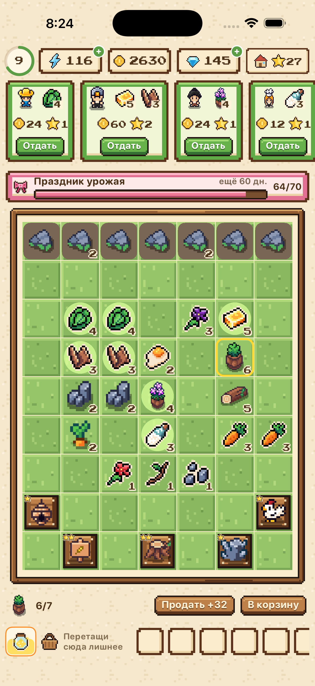 |
| 03-village | Деревня, хутор: постройки и стоимость ремонта | 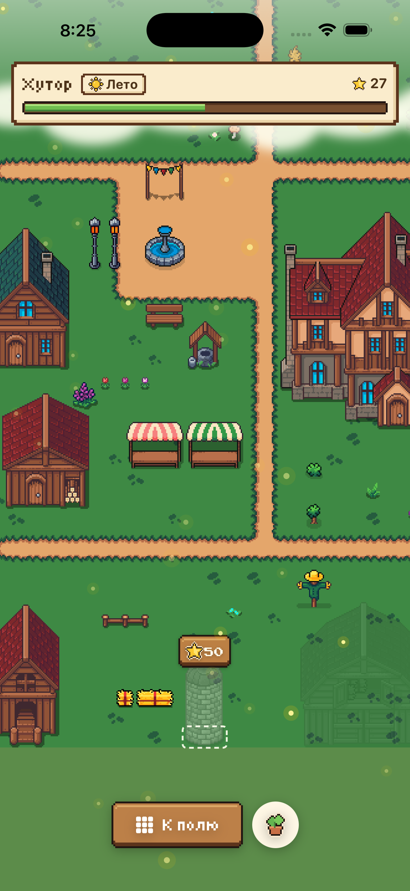 |
| 05-shop | Лавка: подарок дня, копилка, пропуск события, наборы | 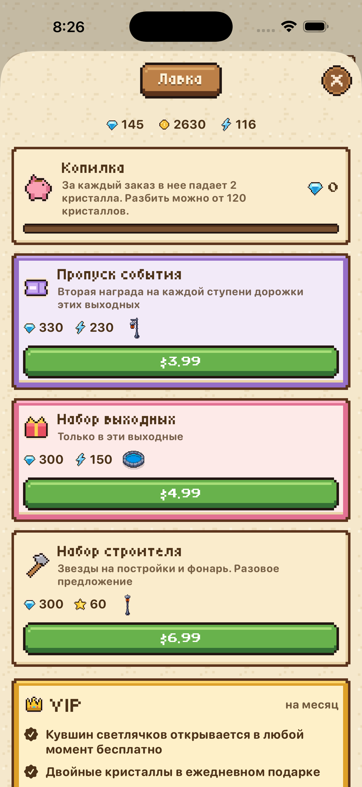 |
| 06-quests | Журнал: задания дня и сундук за все задания | 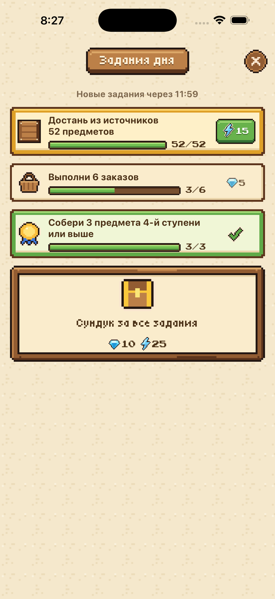 |
| 07-album | Журнал: альбом цепочек предметов | 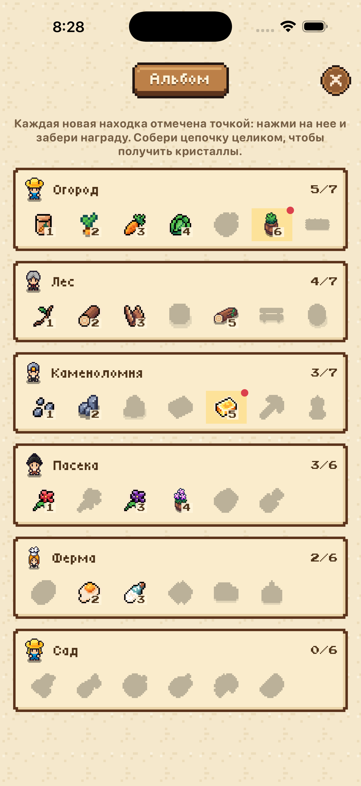 |
| 11-settings | Настройки | 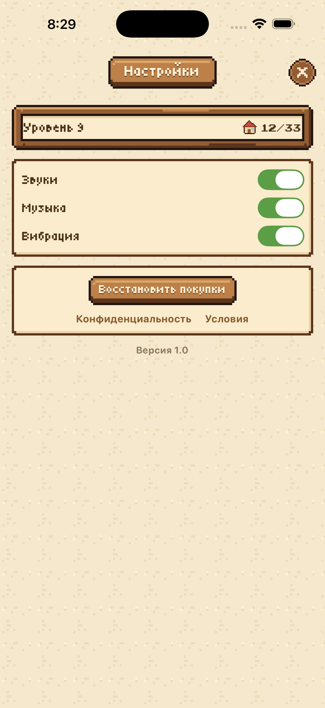 |
| 12-daily-reward | Окно «Подарок дня» | 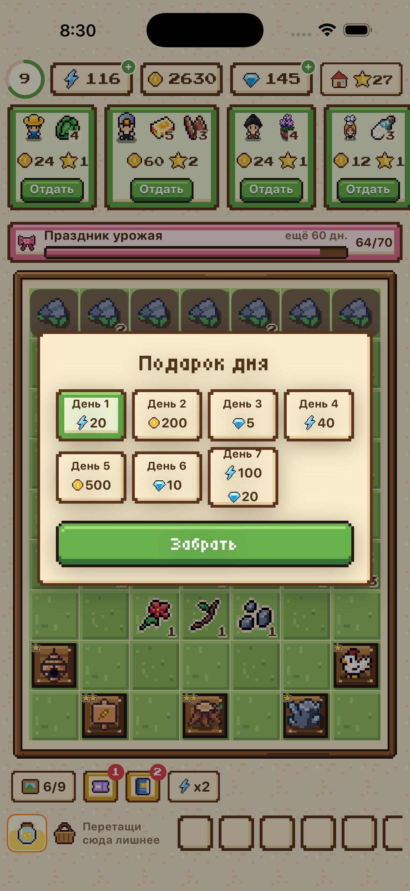 |
| 13-new-resident | Карточка нового жителя (в 1.0 окно нового жителя не появилось в демо-состоянии, на кадре поле) | 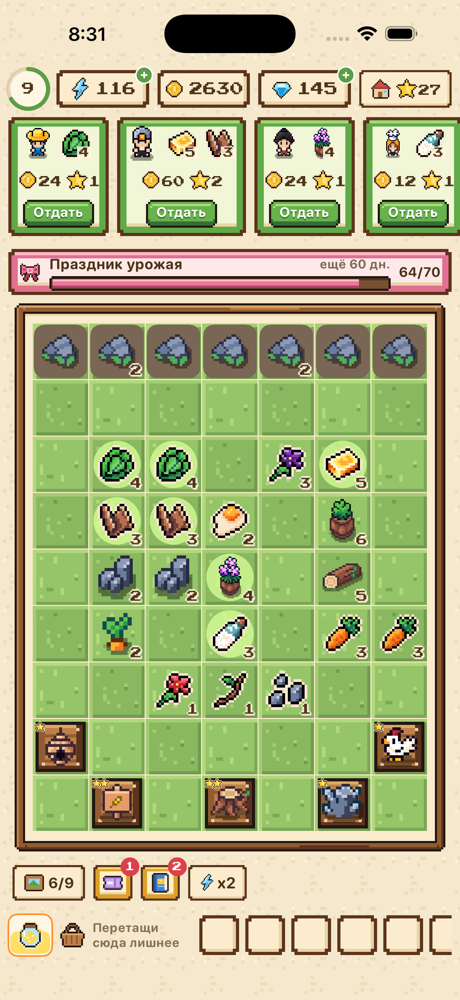 |
| 14-toast | Всплывающее сообщение о выполненном заказе (тост короткий и в кадр не попал, на кадре поле) |  |
| 18-event | Событие выходных «Праздник урожая» | 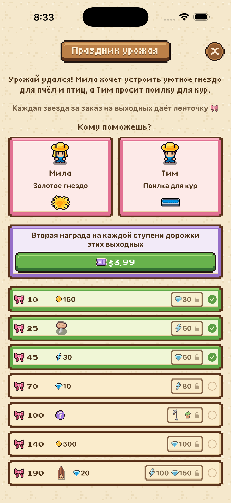 |
| 19-postcard | Открытки | 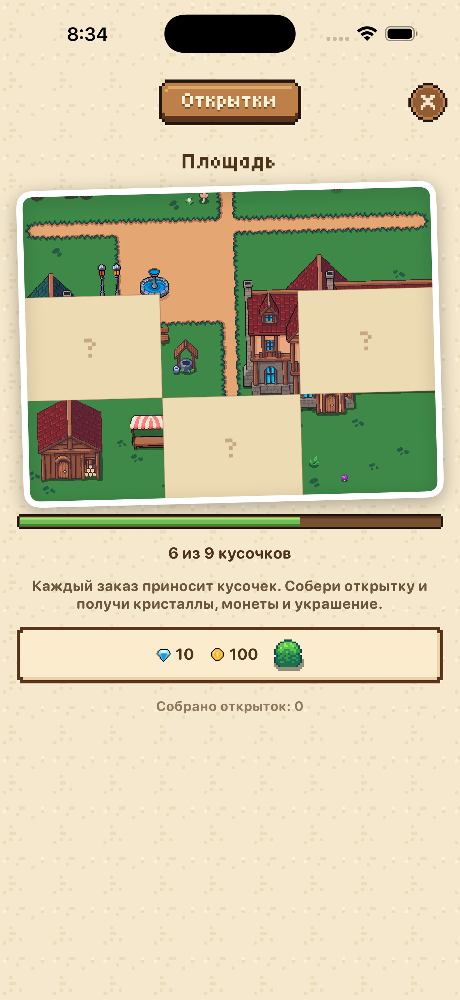 |
| 27-store-board | Скриншот App Store: поле | 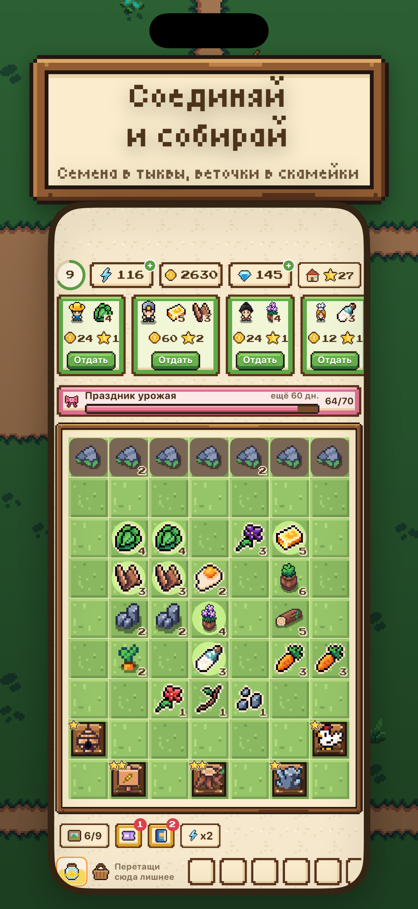 |
| 28-store-village | Скриншот App Store: деревня | 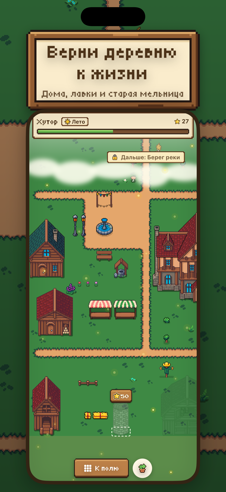 |
| 29-store-event | Скриншот App Store: событие | 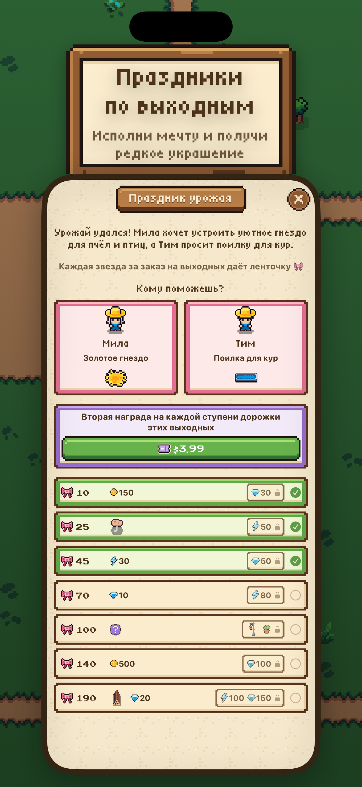 |
| 30-store-north | Скриншот App Store: поздняя деревня | 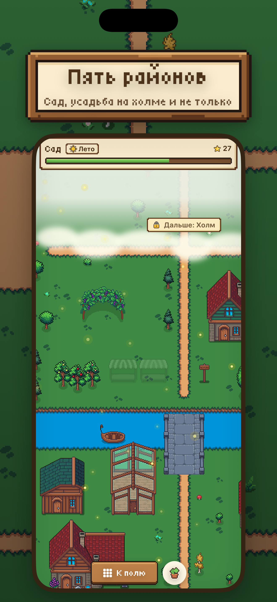 |
| 31-store-postcard | Скриншот App Store: открытки | 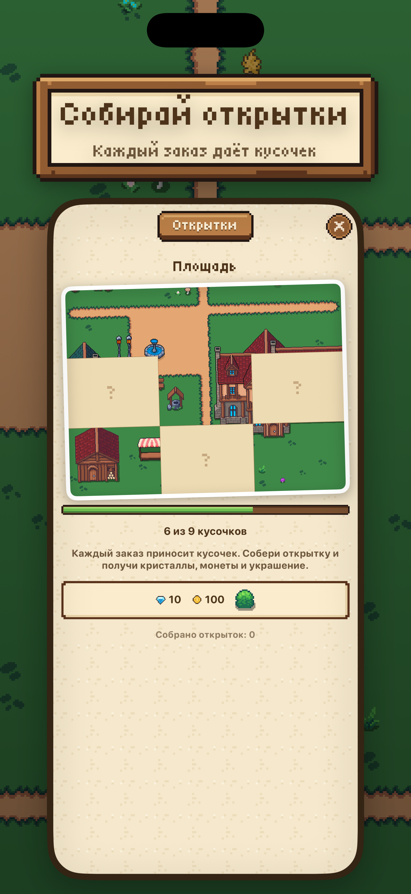 |
